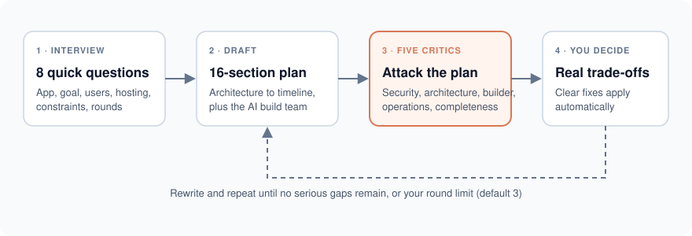

<div align="center">


# PlanForge

**Turn an app idea into a detailed technical plan, then let five critics try to break it.**<br>
A Claude Code skill that interviews you, drafts a 16-section plan, stress-tests it from five angles, and rewrites it before any code is written.

[](LICENSE)
[](https://code.claude.com/docs/en/skills)
[](skills/planforge/references/sections.md)
[](skills/planforge/references/council.md)
[](#install)

[**See an example plan**](examples/porch-library/porch-library.md) &nbsp;·&nbsp; [Install](#install) &nbsp;·&nbsp; [Usage](#usage) &nbsp;·&nbsp; [The interview](#the-interview) &nbsp;·&nbsp; [The council](#the-council) &nbsp;·&nbsp; [Limits](#honest-limits) &nbsp;·&nbsp; [FAQ](#faq)

<br>



</div>

<br>

## Why

Most AI-written plans sound confident and hide gaps. The gaps only show up once someone is building, when changing them is expensive. PlanForge does the uncomfortable part first: it has a panel of reviewers attack the plan, asks **you** only the questions that need a human, and rewrites it.

It runs inside Claude Code on your existing Claude subscription. There is no server, no API key, and nothing to deploy. A skill is just a folder of text files.

## Features

- **Starts with an interview.** Eight short questions, one at a time, with suggested answers. The critics judge the plan against your real goal, not a guess.
- **Does not assume you own a server.** Tell it where the app will live (your own server, Vercel, Cloudflare, a big cloud, an app store, or "recommend one") and the server, deployment, and budget sections adapt.
- **16 sections, no hand-waving.** Architecture, database, server, environment, features, navigation, authentication, integrations, security, QA, error logging, code health, deployment, budget, timeline, and the AI agent team that will build it. Every section must name real tools, never "TBD".
- **Five critics, fresh eyes.** Each reads the plan without the author's reasoning, so the review stays sharp instead of agreeable.
- **You only answer what matters.** Clear fixes are applied automatically. Real judgment calls come to you, one at a time, with options.
- **You set the depth.** Pick 1 to 6 review rounds (default 3). Stop early any time.
- **Resumable.** Every step is saved, so an interrupted plan picks up where it left off.
- **Bring your own plan.** `import` an existing spec and it critiques and gap-fills it, marking anything it had to invent.

## Install

```bash
git clone https://github.com/JackB2003/planforge-skill.git
mkdir -p ~/.claude/skills
cp -r planforge-skill/skills/planforge ~/.claude/skills/
```

Restart Claude Code. The skill is then available as `/planforge`.

> [!NOTE]
> You need [Claude Code](https://code.claude.com/docs/en/overview) on a Claude subscription. Each round starts five subagents, so a full run uses a meaningful amount of your plan. Expect a few minutes per round.

## Usage

```text
/planforge new "My App"          start a plan (begins with the interview)
/planforge import ./my-spec.md   critique and gap-fill a plan you already have
/planforge resume my-app         pick up an unfinished plan
/planforge show my-app           print the sections
/planforge finalize my-app       stop now and write the final plan
/planforge list                  list saved plans
```

Plans are saved as JSON, plus a readable Markdown file when finalized, in `~/planforge-plans/`.

Inside a question you can type `/skip` to skip it, `/discuss` to talk it over with the critic who raised it, or `/finalize` to stop and write the plan with what you have.

## The interview

`/planforge new` asks these before drafting anything. If you already described the app, it pre-fills what you said and only asks you to confirm.

| # | Question | Why it matters |
| --- | --- | --- |
| 1 | What is the app, in a sentence? | Anchors everything else |
| 2 | What is the goal, and what does success look like? | Critics judge the plan against it |
| 3 | Who will use it? | Drives features, security, and scale |
| 4 | What must version one do? | Separates the MVP from the wish list |
| 5 | Where will it live? | Shapes the server, deployment, and budget sections |
| 6 | Any constraints (budget, deadline, tools you already use)? | Prevents plans you cannot afford or ship |
| 7 | Anything it must not do? | Becomes a hard rule for the build agents |
| 8 | How many review rounds? (default 3, up to 6) | More rounds find more, and cost more usage |

## The council

Every round, five reviewers read the plan in parallel and each attack a different weakness.

| Critic | Job |
| --- | --- |
| **Security Auditor** | Assumes the plan ships as written and attacks auth, secrets, uploads, abuse, and trust boundaries |
| **Systems Architect** | Checks the pieces fit together and the sections do not contradict each other |
| **Implementer** | Plays the build agent who has to follow the plan, and reports where it would be forced to guess |
| **Ops/Reliability Engineer** | Checks the stack against how it really behaves in production (can use web search when available) |
| **Completeness Auditor** | Hunts for what is missing: edge cases, rollback, day-one gaps |

A judge then merges the findings, separates fixes from real decisions, and the plan is rewritten.

## See it work

[`examples/porch-library`](examples/porch-library/porch-library.md) is a full run on a made-up app (a neighborhood book-swap map). Open [`porch-library.json`](examples/porch-library/porch-library.json) to see both rounds, every critic finding, and the answers given.

| The round 1 draft looked fine, but the council found | Fixed in round 2 |
| --- | --- |
| Login needed database tables the schema did not have | Added the adapter tables and a role column |
| Any member could edit any library (no ownership checks) | One authorization helper on every write route, plus tests |
| Rate limits reset on every deploy and saw one shared IP behind the proxy | Database-backed limiter, proxy header trusted |
| Staging was promised but had no port, database, or budget | A fully defined staging setup |
| The free email tier would silently stop all logins | Paid plan budgeted, daily send cap added |

Round 2 then found second-order problems (for example, the content security policy would have blocked the bot-check widget on the login page). That example run was ended after round 2 with `/finalize`, so those findings are listed at the bottom of the plan instead of fixed. A normal run continues to the round limit you chose.

> [!NOTE]
> The example was made before the interview step existed, so it shows the earlier flow and assumes a single server.

## Honest limits

- **It plans. It does not build anything.**
- **The critics are Claude subagents**, so they share Claude's blind spots. Treat the output as a strong first review, not a guarantee.
- **Check third-party claims yourself.** The Ops critic can use web search when your setup allows it. In the example run it reported that it had not searched in round 1 and did search in round 2. Verify pricing and policy claims against the live pages before you commit to them.
- **Usage.** Each round starts five subagents. Choose fewer rounds if you are close to your limit.

## FAQ

<details>
<summary><b>Do I need an API key?</b></summary>
<br>
No. It runs inside Claude Code and uses your Claude subscription. Nothing is sent anywhere else.
</details>

<details>
<summary><b>Can it plan an app that is not a website?</b></summary>
<br>
Yes. Pick "an app store or a desktop or phone install" when it asks where the app will live, and the server and deployment sections describe the build and release process instead.
</details>

<details>
<summary><b>I already wrote a spec. Can it review that?</b></summary>
<br>
Yes. Run <code>/planforge import ./my-spec.md</code>. It maps your document into the 16 sections, keeps your real decisions, and marks anything it had to invent with <code>[GAP-FILLED]</code>. It only asks how many rounds you want.
</details>

<details>
<summary><b>Where are my plans stored?</b></summary>
<br>
In <code>~/planforge-plans/</code> as one JSON file per plan, plus a Markdown copy when you finalize. They stay on your machine.
</details>

<details>
<summary><b>Why five critics instead of one?</b></summary>
<br>
A single reviewer tends to say the plan looks good. Splitting the job into five angles, with strict output rules, produces specific findings such as a login flow that cannot be built because a table is missing.
</details>

## Related

Spec-Roast pressure-tests a finished spec before development. Roast pressure-tests an idea before you plan it. Both use the same five-persona council pattern.

## License

[MIT](LICENSE). Built by Jack Bonner.
